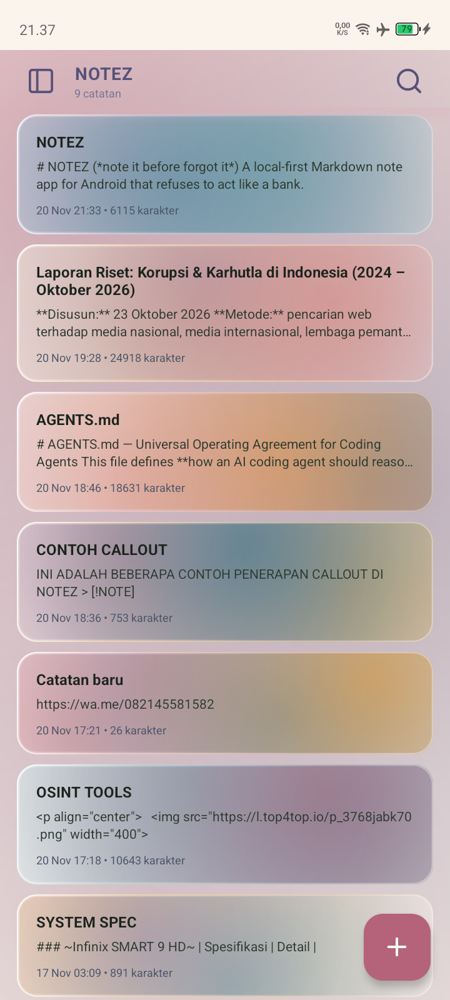
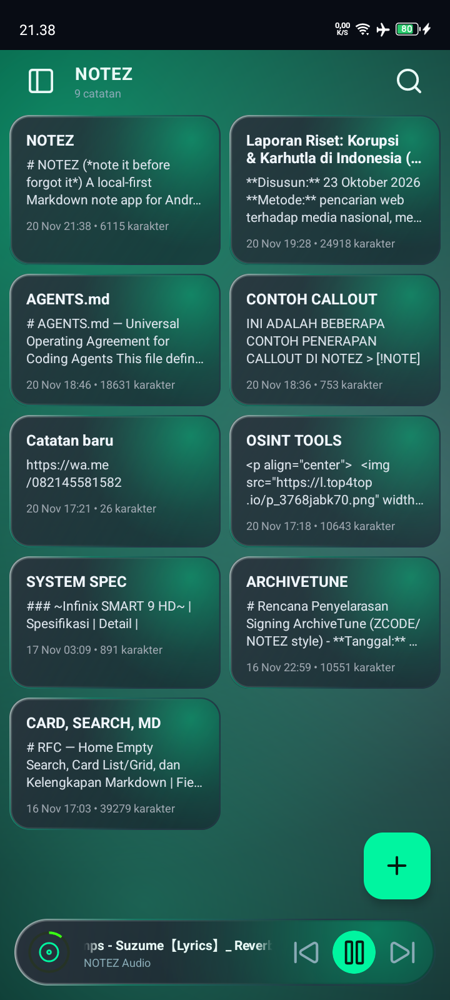
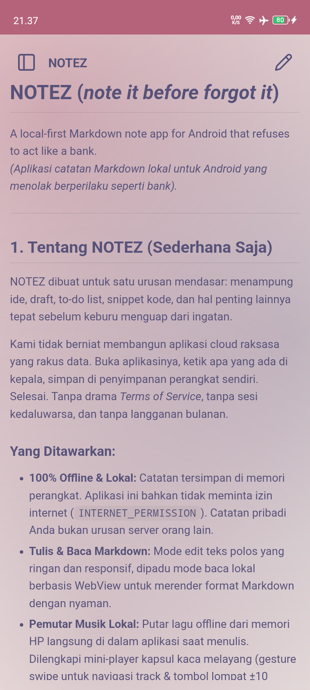
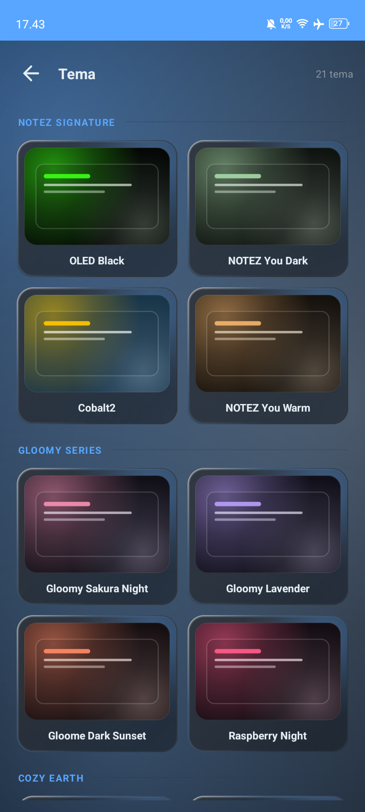
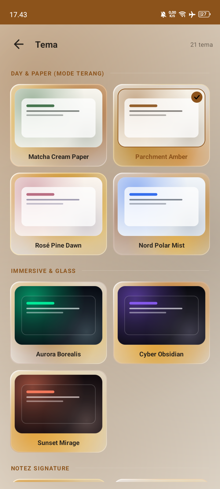
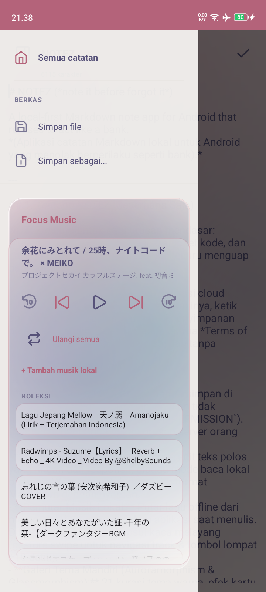

# NOTEZ (*note it before forgot it)

A local-first Markdown note app for Android that refuses to act like a bank.  
*(Aplikasi catatan Markdown lokal untuk Android yang menolak berperilaku seperti bank).*

---

## 1. Tentang NOTEZ (Sederhana Saja)

NOTEZ dibuat untuk satu urusan mendasar: menampung ide, draft, to-do list, snippet kode, dan hal penting lainnya tepat sebelum keburu menguap dari ingatan.

Kami tidak berniat membangun aplikasi cloud raksasa yang rakus data. Buka aplikasinya, ketik apa yang ada di kepala, simpan di penyimpanan perangkat sendiri. Selesai. Tanpa drama *Terms of Service*, tanpa sesi kedaluwarsa, dan tanpa langganan bulanan.

### Yang Ditawarkan:
- **100% Offline & Lokal:** Catatan tersimpan di memori perangkat. Aplikasi ini bahkan tidak meminta izin internet (`INTERNET_PERMISSION`). Catatan pribadi Anda bukan urusan server orang lain.
- **Tulis & Baca Markdown:** Mode edit teks polos yang ringan dan responsif, dipadu mode baca lokal berbasis WebView untuk merender format Markdown dengan nyaman.
- **Pemutar Musik Lokal:** Putar lagu offline dari memori HP langsung di dalam aplikasi saat menulis. Dilengkapi mini-player kapsul kaca melayang (gesture swipe untuk navigasi track & tombol lompat ±10 detik).
- **Galeri Tema Mandiri (Auroramorphism & Glassmorphism):** 21 kurasi tema warna, efek kartu kaca tembus pandang, *instant apply*, dan transisi *snug 14dp topbar fade* yang menempel mulus di batas bawah saat digulir.
- **Organisasi Bersih:** Seleksi massal (tekan lama) untuk menyematkan catatan penting (*Pin*) atau memindahkannya ke Tempat Sampah (*Recycle Bin*) yang memiliki perlindungan pembersihan otomatis 30 hari.
- **Dukungan Berkas Terbuka (SAF):** Simpan dan buka catatan langsung ke format berkas `.md` atau `.txt` lewat Android Storage Access Framework.

---

## 2. Arsitektur Teknis (Jujur & Tanpa Bualan)

Tidak ada kata-kata manis pemasaran di sini. Ini fakta riil dapur pacu NOTEZ:

- **Bahasa & Framework:** 100% Kotlin murni, Android Jetpack, Coroutines, dan StateFlow.
- **Penyimpanan Data:** SQLite lokal melalui Room Database (WAL mode diaktifkan).
- **Mesin Tampilan:** Murni Native Android Views dan Vector Drawables. **0 KB library C++ berat atau runtime shader**, sehingga tetap gesit di HP lawas dengan RAM terbatas.
- **Ukuran Unduhan APK:** **~3.0 MB** (ramping karena string pustaka pihak ketiga disaring hanya untuk konfigurasi bahasa `id` dan `en`).
- **Kompatibilitas Target:** Android 8.0 (Oreo, API level 26) hingga Android 14+ (API level 34). Teruji lancar pada arsitektur ARMv7 32-bit.
- **Integritas Aksara:** 100% aman untuk aksara internasional dan teks RTL (Unicode UTF-8/UTF-16: Arab, Kanji/Kana Jepang, Hangul, Devanagari, serta Emoji).

### Screenshots

  &nbsp;&nbsp;
  &nbsp;&nbsp;
  

  &nbsp;&nbsp;
  &nbsp;&nbsp;
  

---

## 3. Komparasi Terbuka: Kertas vs Cloud Notes vs NOTEZ vs BATU

Sebelum Anda memutuskan memakai NOTEZ, kami harus jujur: **NOTEZ bukanlah media pencatatan terbaik di dunia.**

Gelar media pencatatan paling sempurna sepanjang sejarah peradaban manusia tetap dipegang oleh **BATU**. Berikut bukti audit faktualnya:

### Tabel Adu Fitur Faktual

| Parameter | Kertas | Cloud Note (SaaS) | NOTEZ | BATU 🪨 *(Juara Bertahan)* |
|:---|:---:|:---:|:---:|---:|
| **Daya Tahan** | Hitungan bulan | Selama servernya hidup | Selama HP Anda hidup | **Ribuan tahun** |
| **Butuh Baterai** | Tidak | Iya, dan selalu sekarat | Iya | **Tidak, tapi butuh otot** |
| **Butuh Internet** | Tidak | Wajib | **Nol (Tanpa izin internet)** | **Tidak, kecuali mau pamer** |
| **Biaya Langganan** | Rp0 | $8 - $12 / bulan | **Rp0 (Gratis selamanya)** | **Rp0 (Batu di pinggir kali)** |
| **Fitur Undo** | Tip-Ex | `Ctrl + Z` | `Undo` | **Tidak ada, makanya mikir dulu** |
| **Tahan Air & Kopi** | Hancur | Tergantung casing HP | Tergantung casing HP | **Malah makin estetik** |
| **Notifikasi Iklan** | Nol | Menyerbu tiap minggu | **Nol** | **Nol mutlak** |
| **Bisa Ditimpa Galon** | Sobek | Layar retak | Layar retak | **Galonnya yang pecah** |
| **Ganjal Pintu Rumah** | Nggak kuat | Nggak masuk akal | Merusak HP | **Sangat multifungsi** |

> **Kesimpulan:** Batu menang telak di semua lini. Skor akhir sengaja tidak dicantumkan demi menjaga martabat industri perangkat lunak.

### Kenapa Batu Tetap Unggul?
1. **Tidak bisa di-hack:** Hacker paling jenius di dunia harus berjalan kaki ke rumah Anda untuk membaca catatan Anda.
2. **Tidak ada *sync conflict*:** Hanya ada satu kebenaran tunggal, dan beratnya 14 kilogram.
3. **Bebas *bloatware*:** Batu tidak akan tiba-tiba menawarkan asisten AI untuk "merangkum" daftar belanjaan Anda yang cuma tiga kata.
4. **Memaksa Anda berpikir ringkas:** Memahat *"Beli telur"* itu olahraga. Menulis *"Hari ini aku merenungkan arti kehidupan dan sebutir telur"* adalah cedera otot leher.
5. **Warisan abadi:** Anak cucu Anda tidak akan menemukan folder rusak berisi `catatan_final_v2_REVISI_beneran.docx`. Mereka akan menemukan lempengan andesit, dan mereka akan kagum.

**Kenapa NOTEZ Ada?**  
Karena kami sadar, Anda tidak mungkin mengantongi batu kali seberat 14 kilogram di saku celana jeans Anda setiap hari. NOTEZ adalah kompromi terbaik umat manusia saat ini.

---

## 4. Cara Unduh & Pemasangan

- **GitHub Release:** Unduh berkas resmi `NOTEZ-v0.2.0-release.apk` di tab [Releases](https://github.com/mjurran-zaba/NOTEZ/releases).
- **Google Drive Mirror:** Berkas APK rilis produksi signed tersedia di folder [APK_RELEASE](https://drive.google.com/file/d/1KJ5FVrXm9bsA0g1ob8j6G19uSZ16fFBv/view?usp=sharing).
- **Obtainium:** Masukkan URL `https://github.com/mjurran-zaba/NOTEZ` ke aplikasi Obtainium untuk otomatisasi pelacakan versi baru.

---

## 5. Lisensi

Proyek ini berlisensi di bawah **GNU General Public License v3.0 (GPL-3.0)**.  
Hak Cipta © 2026 **MUHAMMAD ZAQI PRASETYO**.

---

 

> *"Demons and bugs sneered at her: 'Why the fuck do you keep getting back up every time we knock you down?'*  
>  
> *She spat blood into the dirt, looked them dead in the eye, and whispered:*  
> *'Because you hit like a bitch. Now get the fuck out of my way—I don't have time to bleed for you.'*
